### 🛡️ Ciberseguridad | Pentesting | Administración de Sistemas

Enfocado en el aprendizaje práctico, los laboratorios y la documentación técnica.

---

## 🚀 Sobre mí

Estoy desarrollando mis conocimientos mediante laboratorios prácticos de pentesting, hardening de Linux, análisis de vulnerabilidades web y monitorización de eventos de seguridad. Me gusta documentar los procedimientos, analizar los resultados y comprender tanto la explotación de vulnerabilidades como las medidas necesarias para mitigarlas.

**Formación complementaria:** Introducción a Linux — Hack4u.
- 🐧 **Introducción a Linux** – [Hack4u.io](https://hack4u.io/)  
- 👨‍🏫 **Instructor:** Marcelo Vázquez [S4vitar](https://github.com/s4vitar)

---

## 📌 Proyectos destacados

### 🛡️ [Cybersecurity Homelab](https://github.com/seseby/homelab-cybersecurity-portafolio)

Laboratorio de ciberseguridad defensiva en Linux que incluye:

- Hardening de SSH y configuración del firewall UFW.
- Configuración de HTTPS con Nginx.
- Protección frente a ataques de fuerza bruta con Fail2ban.
- Automatización de copias de seguridad.

### 🔎 [CTF & Pentesting Writeups](https://github.com/seseby/Writeups)

**writeups publicados** sobre laboratorios de pentesting y retos de seguridad en entornos controlados.

- SQL Injection y análisis de vulnerabilidades web.
- Bypass de autenticación y análisis de mecanismos MFA.
- Enumeración y explotación de vulnerabilidades.
- Documentación de evidencias técnicas, impacto y recomendaciones de mitigación.

### 📚 [ASIR Vault](https://github.com/seseby/ASIR)

Repositorio de proyectos sobre administración de sistemas, Linux, redes y scripting.

---

## 🛠️ Tecnologías y herramientas

### 🐧 Sistemas y redes

### 🔐 Ciberseguridad

### 🌐 Redes y desarrollo web

### 💻 Programación y herramientas de trabajo

---

## 📫 Contacto

- 💼 **LinkedIn:** [Sebastian Cristea](https://www.linkedin.com/in/sebastiancristeaa)
- 💻 **GitHub:** [@seseby](https://github.com/seseby)

